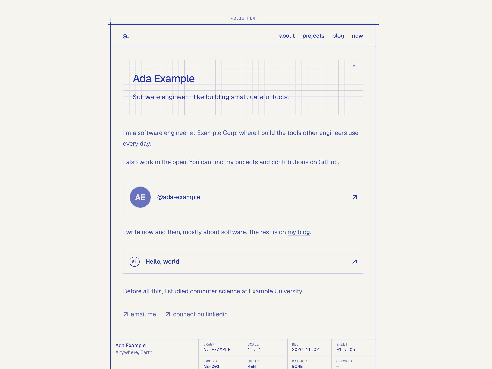
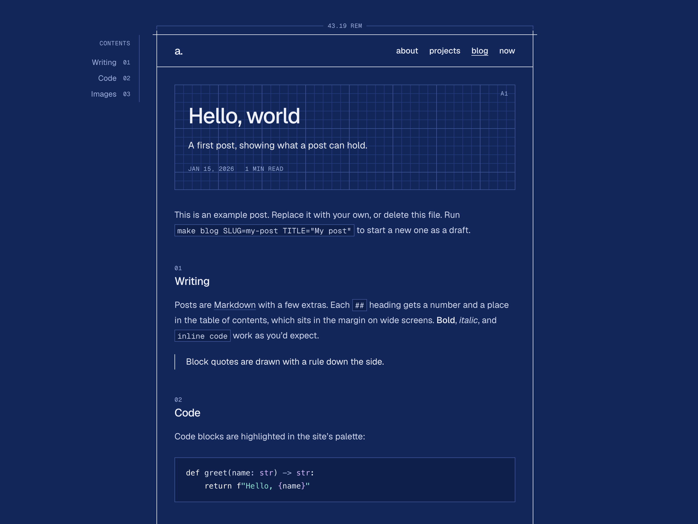
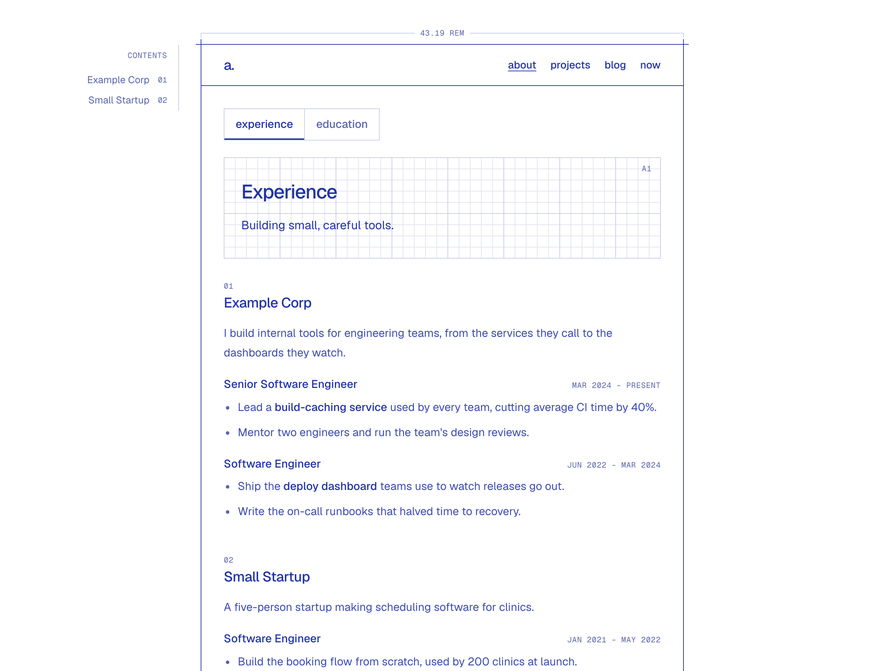

# Blueprint

[](https://vercel.com/new/clone?repository-url=https%3A%2F%2Fgithub.com%2Fflaviaouyang%2Fblueprint&project-name=my-site&repository-name=my-site)

A personal site that looks like an engineering drawing: drafting blue on bone paper, a
framed sheet, grid panels behind each page's title, and a drawing title block as the
footer. Home, About, Projects, a blog, and a Now page, all written in plain files, built
as static HTML with [Astro](https://astro.build), and deployed free on Vercel.

You fill in one file about yourself and you have a site.



<table>
  <tr>
    <td width="50%"></td>
    <td width="50%"></td>
  </tr>
  <tr>
    <td align="center">A post, on blueprint (the dark theme)</td>
    <td align="center">About, on white</td>
  </tr>
</table>

- **Framework:** [Astro](https://astro.build), static output
- **Content:** Markdown and MDX, plus one YAML file about you, checked at build time
- **Styling:** plain CSS from a small set of design tokens; fonts are [Geist](https://vercel.com/font) and Geist Mono
- **Deployment and analytics:** [Vercel](https://vercel.com), with Web Analytics and Speed Insights if you turn them on

## Make it yours in five minutes

**Fastest:** click **Deploy with Vercel** above. It copies this repository into your
GitHub account and puts it online. Then clone your copy and continue from step 2 to make
it yours; every push redeploys.

**Or by hand.** You need [bun](https://bun.sh) and Node 22.23 or newer.

1. **Copy the template.** On GitHub, click **Use this template** → **Create a new
   repository**, then clone your copy.
2. **Install and run it:**

   ```bash
   bun install
   bun run dev
   ```

   Open <http://localhost:4321>. You'll see Ada Example's site.
3. **Make it about you.** Edit `content/profile.yaml`: your name, a one-line tagline,
   links, Home's few paragraphs, your jobs and schooling. The page updates as you save.
   If something is wrong (a typo in a field name, a bad date), the dev server tells you
   exactly where.
4. **Set your address.** In `astro.config.mjs`, change `site: 'https://example.com'` to
   your domain (or your `*.vercel.app` address).
5. **Swap the examples.** Replace or delete `content/posts/hello-world.mdx`,
   `content/projects/example-project.mdx`, and `content/now.mdx`, plus the images in
   `public/images/`.
6. **Deploy.** Push to GitHub, then on [vercel.com/new](https://vercel.com/new) import
   the repository. Vercel reads the build settings from `vercel.json`; there's nothing
   to configure.

Optional finishing touches: your own favicon (`public/favicon.ico`, `icon-32.png`,
`icon-192.png`, `apple-touch-icon.png`) and social-preview image (`public/og.png`,
1200×630).

## Writing

Everything you write lives in `content/`; no copy lives in the code.

| File | What it is |
| --- | --- |
| `content/profile.yaml` | You: name, tagline, links, Home's paragraphs, each page's opening line, experience, education |
| `content/posts/*.mdx` | Blog posts. Start one with `make blog SLUG=my-post TITLE="My post"` |
| `content/projects/*.mdx` | Projects. Add a body to give one its own page |
| `content/now.mdx` | What you're doing now |

[doc/content.md](doc/content.md) explains every field, with examples. In short:

- **Drafts:** add `draft: true` to a post or project to keep it off the live site. It
  still shows in `bun run dev`, marked "Draft".
- **Hiding:** add `hidden: true` to a job or school to take it off the site without
  deleting it.
- **Projects** only appear in the nav once at least one is published.
- **Placeholders:** write `TODO(content)` anywhere you mean to come back to. Production
  deploys refuse to go out while any remain, and list the files.

## What's in the design

- **Papers:** the Material cell in each page's title block switches between bone,
  white, and blueprint (a dark theme: white lines on cyanotype blue). Visitors whose
  system is in dark mode get blueprint automatically.
- **Grid panels** snap to whole cells; hovering one reads out the cell's coordinate.
- **Posts** get numbered sections, a table of contents in the margin, highlighted code,
  numbered figures in a duotone, and optional comments from a Bluesky thread.
- **Fast and accessible:** static pages, two self-hosted fonts (65 KB), about 1 KB of
  JavaScript, light and dark themes that pass WCAG AA contrast, and an RSS feed, sitemap,
  and social-preview tags built in.

## Commands

```bash
bun run dev      # local site at http://localhost:4321
bun run build    # static site in dist/
bun run preview  # serve dist/ locally
make blog SLUG=my-post TITLE="My post"               # new draft post
node scripts/check-urls.mjs http://localhost:4321   # check every internal link
```

If the dev server errors on content that builds fine (usually right after changing
`src/content.config.ts`), clear Astro's cache with `rm -rf .astro node_modules/.astro`,
then start it again.

## Layout

| Path | What it holds |
| --- | --- |
| `content/` | Your writing (see above) |
| `src/pages/` | One file per route |
| `src/layouts/Base.astro` | Page shell: head, framed sheet, nav, title-block footer |
| `src/components/` | Plate (grid panel), SiteNav, TitleBlock, Tabs, Toc, Figure, Replies, Arrow |
| `src/lib/` | Content queries and formatting, the section list (`sections.ts`), URL helpers |
| `src/styles/tokens.css` | Design tokens: colours for each paper, type, spacing, fonts |
| `src/styles/site.css` | Components and page shell, built only from tokens |
| `src/scripts/` | Optional interactions: grid readout, paper switch, TOC highlight, Bluesky replies |
| `src/content.config.ts` | The rules every content file is checked against |
| `public/` | Fonts, images, icons, social-preview image |
| `vercel.json` | Build settings, clean URLs, and security headers |

## Credits and license

[MIT licensed](LICENSE). Designed by [Flavia Ouyang](https://www.flaviaouyang.com). If you use it, a small credit (for example, a link in your README or your site's footer) is appreciated, though not required.
